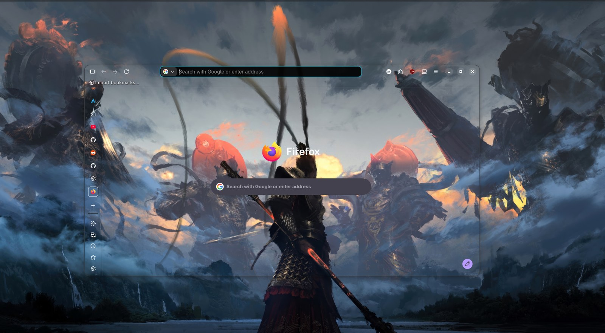
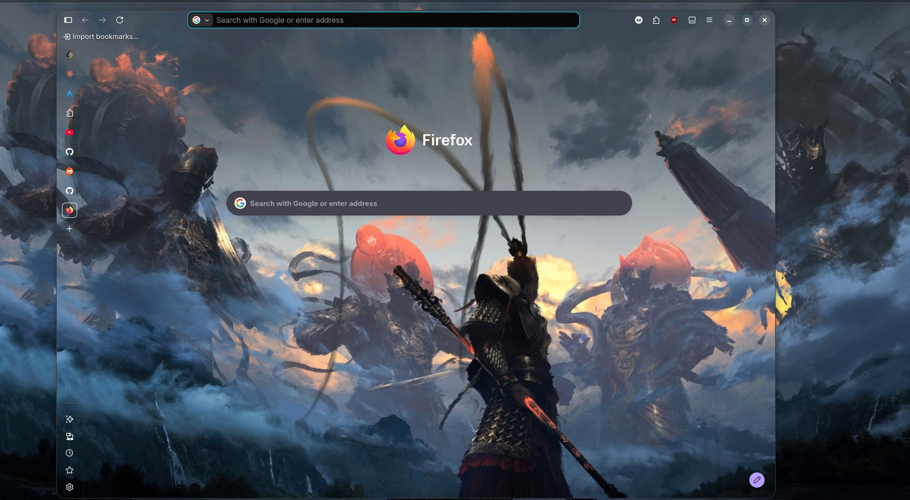

# firefox-transparent-toolbar

A Firefox toolbar that is genuinely see-through, onto your **wallpaper** — not merely
dark, not whichever window happens to be behind it, and still lined up when you move
the window.

https://github.com/user-attachments/assets/0794dbd2-7c4a-4dce-9322-4da9790b779f

Two pieces do it together:

- **`userChrome.css`** makes the Firefox toolbar band — tab strip, address bar and
  bookmarks bar — and the page area actually transparent.
- **[A GNOME Shell extension](gnome-extension/)** puts the real desktop wallpaper
  directly beneath the Firefox window, so those transparent pixels land on your
  wallpaper and not on the editor or chat window sitting behind it. Because it lives in
  the compositor, it stays aligned as you drag, resize or unmaximize the window.

That pairing is the recommended setup and the one this README leads with. Not on GNOME,
or don't want an extension? The stylesheet works on its own too, in one of
[two fallback modes](#without-the-extension).

Written and tested against **Firefox 155 on Linux**, **GNOME Shell 50.4**, Wayland. The
extension supports GNOME Shell 48–51.



An unmaximized window — the wallpaper runs straight through the toolbar and the page
with no seam.



The vertical tab strip is a Firefox setting, not part of this theme — it inherits the
transparency like any other toolbar.

## Install

The order matters: get Firefox transparent first, then add the extension underneath it.
An extension under an opaque Firefox looks exactly like an extension that failed to
load.

1. **Get the files.**

   ```sh
   git clone https://github.com/6meowscles/firefox-transparent-toolbar
   cd firefox-transparent-toolbar
   ```

2. **Find your profile folder.** Open `about:profiles` and copy the **Root Directory**
   of the profile marked *This is the profile in use*.

   Firefox 155 on Linux stores profiles under `~/.config/mozilla/firefox/<id>`.
   Older builds use `~/.mozilla/firefox/<id>`. Don't guess — check `about:profiles`,
   because writing to the wrong one looks exactly like the CSS silently not working.

3. **Embed your wallpaper.** Needs [Pillow](https://pypi.org/project/pillow/)
   (`pip install pillow`).

   ```sh
   python3 embed-wallpaper.py               # reads your current GNOME wallpaper
   python3 embed-wallpaper.py ~/pic.jpg     # ...or any image you like
   ```

   Run **one** of those. Yes, even with the extension: when the sidebar expands on
   hover it floats *over* the page, where CSS cannot reach the compositor's underlay,
   so the stylesheet carries a copy of the wallpaper for that one spot. Skip this and
   the hovered sidebar goes black. The script writes next to *itself*, not into your
   profile — the next step is what puts it there.

4. **Copy both sheets into the profile.** Both, every time you re-run step 3 — they are
   generated together.

   ```sh
   mkdir -p /path/to/your/profile/chrome
   cp userChrome.css userContent.css /path/to/your/profile/chrome/
   ```

5. **Set the prefs** in a `user.js` in the profile root (create it if it isn't there):

   ```js
   user_pref("toolkit.legacyUserProfileCustomizations.stylesheets", true);
   user_pref("browser.tabs.allow_transparent_browser", true);
   user_pref("userchrome.wallpaper.on", false);
   ```

   The first turns user stylesheets on — they've been off by default since Firefox 69.
   The second lets the page area go transparent. The third keeps the stylesheet's own
   [wallpaper mode](#wallpaper-mode) off, because its copy is opaque and would sit on
   top of the extension, hiding it completely while it runs perfectly. Use `user.js`
   rather than `about:config`: it is re-applied at every start, so it survives a
   `prefs.js` rewrite.

6. **Check the filenames.** Graphical editors routinely append `.txt` when saving a new
   file — `user.js.txt`, `userChrome.css.txt` — and file managers hide known extensions,
   so the name *looks* right while the file is simply never read. Nothing warns you. A
   terminal shows the real names:

   ```sh
   ls -a /path/to/your/profile/user.js /path/to/your/profile/chrome/
   ```

   You want exactly `user.js`, `chrome/userChrome.css` and `chrome/userContent.css` — no
   `.txt`, no `.css.css`, and the sheets *inside* `chrome/` rather than beside it. Fix
   with `mv user.js.txt user.js`. To stop it recurring, turn on "show file extensions"
   in your file manager, or create the file from the terminal with `touch` first and only
   then open it in the editor.

7. **Install the extension.**

   ```sh
   cd gnome-extension && ./install.sh
   ```

   It copies the extension in, enables it, and checks the Firefox side for the settings
   above — each of which fails silently, so if steps 4–6 are done its checks come back
   green. Nothing it does needs root. Options, the manual route, and what every check
   means are in [gnome-extension/README.md](gnome-extension/README.md).

8. **Log out and back in.** Not optional on Wayland: GNOME only enumerates extensions at
   startup.

9. **Fully quit Firefox and start it again.** Not just closing the window — the process
   has to exit. Chrome CSS is read once, at startup.

10. **Check it's the real thing.** Unmaximize the window and drag it around. The
    wallpaper behind the toolbar should *track the window* and stay lined up with the
    desktop. If the image stays put while the window moves, you are looking at the
    stylesheet's copy — `userchrome.wallpaper.on` is still `true`. If nothing is
    see-through at all, start at [Troubleshooting](#troubleshooting).

## Tuning

Everything is driven by three variables at the top of the file:

| Variable | Default | What it does |
|---|---|---|
| `--bar-alpha` | `0` | Tint strength over the toolbar band. `0` is fully see-through; raise it if text is hard to read over a busy wallpaper. |
| `--bar-tint` | `20 20 26` | The tint colour, as an `R G B` triplet. |
| `--content-backstop` | `transparent` | Painted behind pages that declare no background of their own. `transparent` lets whatever is behind the window through; set a colour to opt out. |

Restart after editing.

`--bar-alpha` defaults to `0`, not the `0.15` this file described for most of its life,
and the reason is worth knowing. The block declaring these variables was written `:root`,
which matches nothing here — see [the namespace note](#a-note-on-selector-names) — so the
band rendered at `0` no matter what the file said. Fixing the selector while leaving
`0.15` in place would have made a correctness fix arrive as an unannounced restyle. The
derived fills are deliberately *not* zeroed: `--bar-fill-solid` is what keeps the findbar
and the open address-bar panel from going see-through over the page, which was a bug, not
a look.

## How it works

### Why this isn't a theme

Themes can't do it. Firefox paints the window background from your theme's `frame`
colour, and treats that colour as opaque by definition — the comment is right there in
`browser-shared.css`:

```css
:root[lwtheme] & {
  background-color: var(--lwt-accent-color); /* Known opaque */
```

So a theme can set colours *within* an opaque window, but it can't remove the window's
backing. Themes that advertise transparency render as solid black for this reason. Only
a user stylesheet can clear `--lwt-accent-color`, which is what this file does.

### Why the wallpaper needs an extension

A transparent pixel shows what is *directly below it in the stacking order* — the next
window down, not the desktop — and neither Wayland nor Mutter has a "see through to the
wallpaper specifically" mode. No stylesheet can reach past that, because the stylesheet
isn't what does the compositing. So the extension lifts the wallpaper up instead: it
inserts a `Meta.BackgroundActor` for the monitor directly beneath the Firefox window
actor, clipped to the window's frame. The actor is anchored to the monitor and only the
clip follows the window, so what shows through is the part of the wallpaper that
genuinely belongs at that spot on screen. The full explanation, and its known limits,
are in [gnome-extension/README.md](gnome-extension/README.md#why-an-extension-is-the-only-way).

### The page area

`userContent.css` carries the see-through down past the toolbar and into the page area.
Without it the wallpaper stops at the bottom of the bookmarks bar and the window looks
half-finished.

`embed-wallpaper.py` writes that file at the same time as `userChrome.css` — same image,
same screen size — so re-copy both after every run. Restart Firefox and the New Tab page
picks up exactly where the toolbar left off.

**Two modes, following `userchrome.wallpaper.on`.** With the pref `false` the sheet
clears the New Tab canvas, so the page area is genuinely see-through and shows whatever
is behind the window — including the GNOME extension's wallpaper underlay, which stays
aligned as you move the window. With it `true` the sheet paints a copy of the wallpaper
instead, anchored `background-position: right bottom`, which lines up with the real
desktop while the window is maximized.

The see-through half is what `browser.tabs.allow_transparent_browser` in
[install step 5](#install) is for; without it the page area stays opaque whatever the
sheet says.

**An earlier version of this file insisted the canvas could not be cleared on 155**, and
it was wrong in a way worth recording, because the evidence looked conclusive. That test
cleared the background on `:root`, `body`, `#root`, `.outer-wrapper` and `main` and still
got an opaque slab. But every one of those is document-level, and `userChrome.css` was
painting an opaque `--content-backstop` on `.browserContainer` — which sits *below* the
document and *above* the window's alpha. Clearing the document only ever revealed the
backstop, which is indistinguishable from a canvas that refuses to clear. With the
backstop transparent, `background: transparent` reaches the window.

`right bottom`, not `left bottom`: a sidebar is chrome, so it insets the content
viewport's *left* edge while leaving the right edge on the window frame. Anchoring left
slides the whole page sideways by the sidebar's width. Swap both sheets to `left bottom`
if you keep your sidebar on the right.

## Without the extension

Two fallbacks, for when you are not on GNOME or would rather not run an extension. Both
use the same stylesheet; follow [Install](#install) and skip steps 7 and 8.

### See-through only

What you get from [Install](#install) without steps 7 and 8. The toolbar and page
area are genuinely transparent — to whatever is *actually* behind the window. Over a
bare desktop that is your wallpaper, and it looks exactly like the screenshots above.
Over another window, it is that window. You can skip step 3 here, at the cost of a sidebar that turns to a plain
scrim on hover.

### Wallpaper mode

True transparency is transparent to whatever is actually behind the window — which is
usually another window, not your desktop. If you want the wallpaper to show *regardless*
of what's behind Firefox, this mode paints your wallpaper as the window's own
background, positioned to line up with where the window sits on screen. Terminal
emulators call this pseudo-transparency.

Follow [Install](#install), skipping steps 7 and 8, with two differences:

- **Step 3 is required**, not just for the sidebar — the embedded copy *is* the
  wallpaper in this mode.
- **In step 5, set `userchrome.wallpaper.on` to `true`.** Keep it in `user.js`: a
  `false` left there is re-applied at every start and puts the old value straight back.
  Once Firefox has started, the pref also toggles live in `about:config` — `true` for
  the wallpaper, `false` for genuine see-through.

And leave the extension off (`gnome-extensions disable
firefox-wallpaper-underlay@6meowscles.github.io` if you installed it) — its underlay
would be running perfectly and invisible under the opaque copy.

**Copy both sheets, every time.** The script rewrites `userChrome.css` and
`userContent.css` together, and they position their copies by the same rule. Ship one
without the other and the toolbar and the page area disagree — the image reads as
offset across the whole window, which looks nothing like the "one file is stale" problem
it actually is. And the script writes next to *itself*, not into your profile: running
it and forgetting the `cp` leaves the profile on the previous image, which is the
single easiest way to lose an evening here.

The script scales and centre-crops the image to your screen the way GNOME's `zoom`
option does, so the copy matches the real desktop, then embeds it in the stylesheet as a
`data:` URI.

The size it targets is your screen in **logical** pixels, which is what chrome CSS is
laid out in — not the panel's physical mode. Those agree only at 100% scaling: a
2560x1600 panel at 133% is 1920x1200 to the stylesheet, and embedding 2560x1600 there
paints the wallpaper a third too large. The scale comes from `~/.config/monitors.xml`
and is divided out automatically; `--scale=1.3333` overrides the detected factor and
`--screen=1920x1200` overrides the result outright.

**Nothing to calibrate.** The copy is anchored to the window's bottom-right corner,
which on a maximized window *is* the screen's bottom-right corner — whatever the height
of your panel above it or the width of a sidebar beside it. `userContent.css` anchors the
same way, so the toolbar and the page agree across the seam. Verified pixel-for-pixel,
with and without vertical tabs.

If you keep your sidebar on the *right*, swap both sheets to `left bottom`: it's the
right edge that then stops being the window's.

**What you're trading.** It's a picture, not a window into the desktop, so it's only
aligned while Firefox is **maximized** — move or unmaximize it and the image stays put
while the window doesn't. It won't follow a wallpaper change either; re-run the script.
Nor a **display-scale change**: the logical screen size is written into both sheets as
fixed pixels, so changing the scale leaves the copy the wrong size until you re-run the
script — see [Troubleshooting](#troubleshooting).
You can have "always shows the wallpaper" or "always correct as the window moves", not
both.

## Switching between the two modes

Going from wallpaper mode to the extension is not just the pref. The stylesheet
changed shape when the extension landed, so a profile set up for wallpaper mode has
two things in it that make the extension look broken: an opaque `--content-backstop`,
which leaves the page area a slab while the toolbar goes see-through, and the sidebar's
wallpaper rule still inside the pref gate, which turns the hovered sidebar black.

**You still need `embed-wallpaper.py`.** This is the part that surprises people. The
extension supplies the wallpaper for the toolbar and the page area, but not for the
hovered sidebar — when the launcher expands it floats *over* the page, and CSS cannot
reach the compositor's underlay to fill it. So the sidebar carries a copy in both
modes, and one `url()` in `userChrome.css` now sits outside the pref gate. Skip the
embed step and the sidebar falls back to its scrim and goes black on hover.

### Wallpaper mode → the extension

1. **Pull.** Sheets from before the extension landed are missing both fixes above.

   `embed-wallpaper.py` rewrites the tracked sheets in place, so if you have run it
   the pull will refuse. Throw the embedded copies away first — step 2 regenerates
   them:

   ```sh
   cd firefox-transparent-toolbar
   git checkout -- userChrome.css userContent.css
   git pull
   ```

2. **Re-embed.** The pull replaces the repo sheets with the 1×1 placeholders, and the
   copies in your profile are the old structure — so neither side is reusable as-is.

   ```sh
   python3 embed-wallpaper.py           # or point it at a file
   ```

   It writes next to itself in the repo, not into your profile.

3. **Copy both sheets in.** Both, every time — they are generated together and
   position their copies by the same rule.

   ```sh
   cp userChrome.css userContent.css /path/to/profile/chrome/
   ```

4. **Set the prefs** in the profile's `user.js`, not `about:config` — `user.js` is
   re-applied at every start and would put the old value straight back:

   ```js
   user_pref("userchrome.wallpaper.on", false);
   user_pref("browser.tabs.allow_transparent_browser", true);
   ```

5. **Install the extension.**

   ```sh
   cd gnome-extension && ./install.sh
   ```

   Doing 2–4 first means the script's checks come back green and confirm the work,
   instead of listing what is still missing. If you ever installed the older
   `@localhost` build, it offers to remove it — a directory whose name no longer
   matches its `uuid` is a second broken extension, not dead weight.

6. **Log out and back in**, then **fully quit Firefox and start it again**.

7. **Check it is the real underlay.** Unmaximize the window and drag it: the wallpaper
   should *track* the window. If it stays put you are still looking at the CSS copy,
   and the pref did not take.

### The extension → wallpaper mode

Set `userchrome.wallpaper.on` back to `true` **and** disable the extension:

```sh
gnome-extensions disable firefox-wallpaper-underlay@6meowscles.github.io
```

Both at once is the failure this whole arrangement is easiest to fall into: the
extension loads, works perfectly, and is completely invisible under the stylesheet's
opaque copy — which reads exactly like an extension that never loaded.

## Troubleshooting

**After changing the display scale, the wallpaper is smaller (or bigger) than the
screen.** This only happens in wallpaper mode. `embed-wallpaper.py` writes the screen size in
**logical** pixels (physical ÷ scale) into the sheets as literal numbers:
`--wallpaper-screen-w/h` and the sidebar rule in `userChrome.css`, and `background-size`
in `userContent.css`. Change the scale and Firefox's logical screen changes, but those
numbers don't. The copy is anchored bottom-right, so an image that is now too small
covers only that corner, with bare window around it. A wallpaper that looks *smaller*
means the scale went down since you embedded it. A cropped, zoomed-in wallpaper means it
went up. For example, a 1920x1080 laptop embedded at 125% gets 1536x864, and back at 100%
Firefox lays out 1920x1080.

You have two fixes. One keeps wallpaper mode; the other switches to the extension.

*Keep wallpaper mode: re-embed at the new scale.*

1. **Log out and back in** if you haven't since changing the scale. The script reads the
   scale from `~/.config/monitors.xml`, so this makes sure it sees the new value.
2. **Re-run the script and read what it prints:**

   ```sh
   python3 embed-wallpaper.py
   ```

   It should say e.g. `Display 1920x1080 at 1.25x scale -> 1536x864 logical pixels`, and
   nothing at all at 100%. If the scale it names is not the one in Settings → Displays,
   pass it yourself: `--scale=1.25`, or `--screen=1536x864` to give the result outright.
3. **Copy both sheets in.** The script writes next to itself, not into your profile:

   ```sh
   cp userChrome.css userContent.css /path/to/profile/chrome/
   ```

4. **Fully quit Firefox and start it again.** Chrome CSS is read only at startup.

You will have to repeat this every time you change the scale.

*Switch to the extension: almost nothing depends on the scale.* The extension shows
GNOME's own background actor and sizes it from the monitor, not from a number in the
sheet, so the toolbar and page area stay right at any scale. It also tracks the window
when you move or unmaximize it. Follow
[Wallpaper mode → the extension](#wallpaper-mode--the-extension) from step 1. Two things
matter coming from this problem:

- **Step 2 still re-embeds, and it has to be at the new scale.** The hovered sidebar
  carries a copy in both modes, and its size is written into the sheet like everything
  else. Do the logout from step 1 above first and check the line the script prints. If
  you skip this, the sidebar copy keeps the old size even though the rest of the window
  is right.
- **Step 4 turns `userchrome.wallpaper.on` off in `user.js`.** Leave it on and the
  stylesheet's copy, still at the wrong size, is painted over the extension's correct
  underlay. Then nothing looks fixed.

After that, a later scale change affects only the hovered sidebar. Re-run the script
and copy the sheets in again to fix it.

**Nothing changed at all.** Rule out the filename first — `user.js.txt` and
`userChrome.css.txt` are what a graphical editor writes if you let it, and a file manager
that hides extensions will show both as correctly named. `ls -a` in a terminal is the only
reliable check; see install step 6. Then confirm the pref is actually set and that you
edited the profile `about:profiles` says is in use. To prove the sheet is being loaded, add
`#nav-bar { background-color: #ff00ff !important; }` on the **first** line and restart —
a magenta address bar row means the file is live and the problem is elsewhere. Put it
first, not last: if anything further down the file is malformed, a probe at the end is
dropped along with it and you learn nothing.

**A rule you added does nothing, and the selector looks correct.** Check the namespace
before you touch the declaration. This file declares XUL as its default namespace, which
silently restricts any selector whose element half is unqualified — including one written
only as a pseudo-class. `:root` is the trap that has cost the most time here: on Firefox
155 the root of `browser.xhtml` is `<html id="main-window">` in the **XHTML** namespace,
so `:root` parses, matches nothing, and reports no error at all. Every root-level rule in
this file is therefore written `html|html`, the same way `body` is written `html|body` and
the sidebar `html|sidebar-main`.

It fails silently, so prove the *selector* before debugging the *declaration* — and put
the probe on the first line, because one at the end is dropped along with anything
malformed above it:

```css
html|html html|sidebar-main:hover { outline: 4px solid lime !important; }
```

A green ring means the selector matches and the problem is your declaration. No ring
means the selector never matched. Swapping `html|html` for `:root` in that probe is the
quickest way to see the difference for yourself.

**The bar is still a solid block, and the sheet *is* loading.** Your theme is probably
painting a `theme_frame` image. Firefox draws it on `<body>` whenever the image isn't in
the toolbox:

```css
:root:not([theme-image-in-toolbox]) body { background-image: var(--toolbox-background-image); }
```

Plenty of themes ship a flat single-colour band as that image, which covers the whole
toolbar and looks identical to an opaque background. This file already clears it. Note
the rule needs an `html|` prefix — a user stylesheet declares XUL as its default
namespace, so a bare `body` selector matches a XUL element and silently never applies.

**After a system update the bar shows the window behind Firefox, not the wallpaper.**
The stylesheet is fine; the extension stopped loading. A GNOME Shell major-version bump
(50 → 51 on CachyOS in October 2026) leaves the extension installed and listed as
enabled, but the shell refuses to load any extension whose `metadata.json` doesn't name
the running major version. It logs nothing to the journal and shows nothing on screen.
With no underlay, the see-through toolbar falls back to plain transparency, which is
exactly what see-through-only mode looks like. So it reads as the extension
"breaking" when it was never started. One command tells the two apart:

```sh
gnome-shell --version
gnome-extensions info firefox-wallpaper-underlay@6meowscles.github.io
```

`State: OUT OF DATE` is this case. Pull the repo (or add the new major to
`shell-version` in `gnome-extension/metadata.json` yourself), re-run
`gnome-extension/install.sh`, and log out and back in. The shell checks versions only at
startup, so toggling the extension off and on is not enough. Before adding a version by hand, check
that the APIs `extension.js` calls still exist in the new release. Flipping
`disable-extension-version-validation` also works, but it un-gates every extension on
the system, not just this one.

On Arch and derivatives, `gnome-extension/install.sh --pacman-hook` makes the next
upgrade warn you about this in the pacman output, before you log out. See the
[extension's options](gnome-extension/README.md#options).

**The bar goes dark instead of showing the desktop.** Your compositor isn't giving the
window an alpha channel. Nothing in CSS fixes that; raise `--bar-alpha` and treat it as
a tint instead.

**One toolbar row stays opaque grey.** On Linux, toolkit's `toolbar.css` paints every
`<toolbar>` with the GTK `-moz-headerbar` colour. Clearing `background` isn't enough
while the widget is still natively themed — it needs `appearance: none` too.

**Your edits do nothing, but the sheet was working before.** Chrome CSS is read once,
at process start, so a Firefox that was already running when you saved the file will
never see it — and closing the last window doesn't end the process. Compare the two
timestamps:

```sh
ps -o lstart= -p $(pgrep -f lib/firefox/firefox | head -1)
stat -c %y ~/.config/mozilla/firefox/*/chrome/userChrome.css
```

If the process is older than the file, that's the whole problem. `pkill firefox`, wait
for `pgrep firefox` to print nothing, then start it again.

**You used "Refresh Firefox" and everything stopped.** A reset creates a *new* profile
directory and parks the old one in `~/Desktop/Old Firefox Data`. Your `chrome/` folder
and your prefs stay behind with the old one, so the browser comes back looking untouched
while every file you edited is intact but unused. The new directory differs from the old
by eight random characters, so resolve it rather than eyeball it:

```sh
FF=$HOME/.config/mozilla/firefox
echo $FF/$(grep -m1 "^Default=" $FF/installs.ini | cut -d= -f2)
```

Keeping both prefs in `user.js` rather than `about:config` means the next reset costs
only the file copy — `prefs.js` is wiped, `user.js` is re-applied at every start.

**Wallpaper mode is on but you still get see-through.** Two things to check. The
stylesheet in your *profile* may still hold the 1×1 placeholder: an un-embedded file is
about 8 KB, an embedded one over a megabyte, so `ls -l` tells them apart at a glance.
And the pref has to exist as a real **Boolean** — `@media -moz-pref()` won't match a
string `"true"`. To prove the media query is matching, add this and restart; a green
address bar means wallpaper mode is live and the image is the thing to look at:

```css
@media -moz-pref("userchrome.wallpaper.on") { #nav-bar { background: lime !important; } }
```

**The toolbar and the page area show different parts of the image.** You copied one
sheet and not the other. They are generated together and position their copies by the
same rule; re-copy both and restart.

**Everything in the file stops applying at once.** Something structural is broken. An
unmatched `{` swallows the rest of the file, and a `/*` that lost its `*/` does the same
while leaving the braces looking balanced:

```sh
python3 -c "
t=open('userChrome.css',encoding='utf-8').read()
print('braces', t.count('{'), t.count('}'))
print('comments', t.count('/'+chr(42)), t.count(chr(42)+'/'))
"
```

Both pairs must match *each other*. The absolute numbers move every time the file
changes, so compare `{` against `}` and `/*` against `*/` rather than against any figure
quoted here. This is worth checking any time you have hand-edited an embedded sheet: the `data:` URI is a single
line of roughly a megabyte, and some editors will happily reflow or truncate it.

**Check the whole install in one command.** Prints the profile Firefox actually uses,
whether both prefs are set, and whether the wallpaper is really embedded:

```sh
bash -c '
FF=$HOME/.config/mozilla/firefox
if [ ! -d "$FF" ]; then FF=$HOME/.mozilla/firefox; fi
P=$FF/$(grep -m1 "^Default=" "$FF/installs.ini" | cut -d= -f2)
S=$P/chrome/userChrome.css
echo "profile in use: $P"
if [ -f "$S" ]; then
  stat -c "  userChrome.css: %s bytes, saved %y" "$S"
  if grep -q "base64,iVBORw0KGgoAAAANSUhEUgAAAAEAAAABCAYAAAAfFcSJ" "$S"; then
    echo "  PLACEHOLDER - wallpaper not embedded"; else echo "  wallpaper embedded"; fi
else echo "  MISSING at $S"; fi
if [ -f "$P/chrome/userContent.css" ]; then echo "  userContent.css: present"
else echo "  userContent.css: absent (page area stays opaque)"; fi
for f in "$P"/user.js.txt "$P"/chrome/*.txt "$P"/userChrome.css "$P"/userContent.css; do
  [ -e "$f" ] && echo "  MISNAMED OR MISPLACED: $f"
done
grep -h "legacyUserProfileCustomizations" "$P/user.js" "$P/prefs.js" 2>/dev/null
grep -h "userchrome.wallpaper.on" "$P/user.js" "$P/prefs.js" 2>/dev/null
'
```

**The sidebar is left expanded and tinted after the window sits idle.** Firefox's
`expand-on-hover` sidebar can be left in the hover state when the pointer stops being
over it *without a leave event reaching Gecko* — the screen blanking, or focus moving
elsewhere, rather than the mouse actually travelling off it. As far as the stylesheet
is concerned `:hover` is still matching, so the sidebar keeps both its expanded width
and its background. Moving the pointer onto the sidebar and off again, or Alt-Tabbing
away and back, clears it.

Nothing in this repo can fix that: `:hover` is Gecko's, and there is no CSS that
un-latches it. What the stylesheet can do is make the stuck state harmless, which is
why the sidebar's wallpaper copy is gated on `html|html[sizemode="maximized"]` — a copy is
anchored to the window while the extension's underlay is anchored to the monitor, so
unmaximized the two disagree and the sidebar would meet the page in a hard vertical
seam. Gated, it falls back to the plain scrim instead.

If you would rather not have the behaviour at all, set `sidebar.visibility` to
`always-show` or `hide-sidebar` (the third value is `expand-on-hover`), or turn
`sidebar.expandOnHover` off.

## A note on selector names

Two things bite here. The first is namespaces — a bare `body`, `sidebar-main` or `:root`
never matches, and the [troubleshooting entry above](#troubleshooting) covers why and how
to prove it. The second is renaming.

Firefox 155 renamed several theme variables. Older guides still reference
`--toolbar-bgcolor` and `--tab-selected-bgcolor`; the current names are
`--toolbar-background-color` and `--tab-background-color-selected`. If you're adapting an
older snippet and half of it seems to do nothing, that's usually why.

**The wallpaper doesn't paint, but the rest works.** The `data:` URL has to sit
literally in `background-image`. Routed through a custom property — `--wallpaper: url(...)`
then `background-image: var(--wallpaper)` — it parses without error and silently never
paints. Referencing the image by path doesn't work either: a chrome document won't load
a `file://` image, and a relative `url()` inside a custom property resolves against the
document's `chrome://` base URI rather than the stylesheet. Hence embedding.

## License

GPL-2.0-or-later — see [LICENSE](LICENSE). The GNOME extension is licensed the same
way, which is what extensions.gnome.org requires; see
[gnome-extension/SUBMISSION.md](gnome-extension/SUBMISSION.md).
